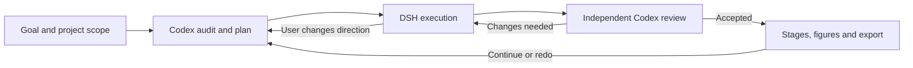

# Brilliant Researcher (BRI)

**An agent researcher built on ARIS, with a local workbench for execution, independent review, and continued iteration.**

[中文](README_CN.md) · [Workbench guide](docs/research-workbench.md) · [Architecture](docs/architecture.md)

Brilliant Researcher brings research goals, native coding agents, project conversations, research stages, and deliverables into one local dashboard. The default collaboration pairs **DSH as executor** with **Codex as independent reviewer**: execute a task, review its actual artifacts, repair the findings, and keep iterating. A new request can begin with a Codex audit of existing work and a concrete plan.

BRI builds on [ARIS — Auto-claude-code-research-in-sleep](https://github.com/wanshuiyin/Auto-claude-code-research-in-sleep). The included MIT-licensed files derive from [`2132036060e03e8d0df69a4b21e5971819c0c2d6`](https://github.com/wanshuiyin/Auto-claude-code-research-in-sleep/tree/2132036060e03e8d0df69a4b21e5971819c0c2d6) in [upstream/aris](upstream/aris). This release vendors selected public ARIS files with local integration adaptations, rather than a pristine complete upstream checkout. ARIS supplies the research skills and workflows; BRI adds the workbench and agent coordination around them. See [NOTICE](NOTICE) and the [upstream license](upstream/aris/LICENSE).

## What BRI adds

- A local project workbench: goals and scope, stage progress, native session activity, questions, and permissions.
- Persistent project conversations, backed by native DSH and Codex sessions; steer ongoing work from the same conversation.
- Independent artifact review and automatic repair within the authorized project scope.
- Codex audit and planning before continued iteration or stage redo, with previous rounds retained.
- Figure discovery, stage association, deliverable ZIP export, and completed-project organization.



You can also start with a specific task instead of an audit. Free collaboration, an individual ARIS skill, and the full research workflow are distinct choices. Selecting a workflow or seeing a skill in the catalog does not mean it has run or passed review.

## Install and open the workbench

Requirements: **Node.js 24**, npm, and **Python 3** for ARIS helpers. The backend runs TypeScript directly and uses `node:sqlite`; an older Node installation is insufficient. Git is needed to clone the repository.

```sh
git clone https://github.com/ahian-lee/brilliant-researcher.git
cd brilliant-researcher
npm ci
npm run setup
npm run build
npm start
```

Open [http://127.0.0.1:8791](http://127.0.0.1:8791). Setup prepares local configuration; it does not install coding agents or provision model credentials. A running dashboard alone does not verify agent execution or scientific results. Use **EN / 中文** in the top bar for an English or Chinese interface; project content, agent output, and upstream skills retain their original language.

The workbench runs natively on Windows. Bash-based ARIS helpers currently run through WSL on Windows; install Python 3 and any dependencies needed by your selected skill there. Linux and macOS compatibility is intended, but complete platform workflows have not all been tested.

## Connect real coding agents

Install DSH and Codex separately and configure their model access. You need a working DSH profile with an available model and credentials, and an authenticated Codex installation. Model/API usage may incur provider charges; BRI does not supply API keys, subscription access, or free inference. Individual research skills may also require browser tools, LaTeX, scientific packages, datasets, or other services.

Edit `var/native-runtime.local.json` using [examples/native-runtime.example.json](examples/native-runtime.example.json) as a reference; copy the example only if the local file is missing. Set your agent executable paths, DSH installation and profile, and `enabled: true` for the configured agents. Start the native runtime in a second terminal:

```sh
npm run runtime
```

The dashboard and runtime must both remain running for collaboration. Closing the browser does not stop them; closing a terminal can. For managed Windows background hosting, see [Architecture](docs/architecture.md#windows-background-hosting).

The reviewer is selected from the available Codex model catalog. To choose a specific reviewer model and effort, set `reviewer.model` and `reviewer.thinkingOptionId` in `var/workbench.local.json`; an unavailable choice is rejected before creating sessions.

The implemented native drivers are DSH and Codex. Other agents can be added through the [NativeDriver interface](packages/adapters/src/native/types.ts); this is an extension point, not a claim that every agent is supported. Historical Pi/Direct integrations remain for compatibility and are not the default workbench path. Paseo is not required.

## Use and interpretation

Create a project with a clear goal, workspace, and constraints on cost, network use, and operations outside that workspace. Start a small task, inspect the artifacts and independent review, then expand the workflow. The [workbench guide](docs/research-workbench.md) describes questions, direction changes, iteration, export, and history.

`accepted` means that the corresponding artifacts passed the configured independent review. It is not a guarantee of scientific correctness. `done` or a completed agent turn only means execution ended. An audit returning `no_change` produces `audited` without new execution or new scientific acceptance.

The dashboard and runtime are designed for **localhost on a trusted machine**, without an internet-facing authentication boundary. Do not expose their ports to the internet. A full-access runtime option increases tool capability; it does not enlarge the user's authorized scope. See [SECURITY.md](SECURITY.md).

## Validation status

Native execution, independent review, user questions, automatic repair, and direction synchronization have been exercised on representative components. An iteration through a new audit plan, a mid-run direction update, a revised plan, execution, and acceptance has also completed with real agents. Some failure, unknown-state, and `no_change` branches are covered by isolated tests rather than live research runs.

These observations do not establish that every bundled ARIS skill, every model, or a complete scientific research program has been validated. Repository tests and CI exercise software behavior; provider access and real research runs are separate checks. Private research data, credentials, and raw session records are excluded from this public source release.

## Develop and contribute

```sh
npm test
npm run test:workbench
npm run build
```

See [CONTRIBUTING.md](CONTRIBUTING.md), [Architecture](docs/architecture.md), and [CHANGELOG.md](CHANGELOG.md). BRI is released under [MIT](LICENSE); preserve upstream attribution and any additional notices included with third-party files.
