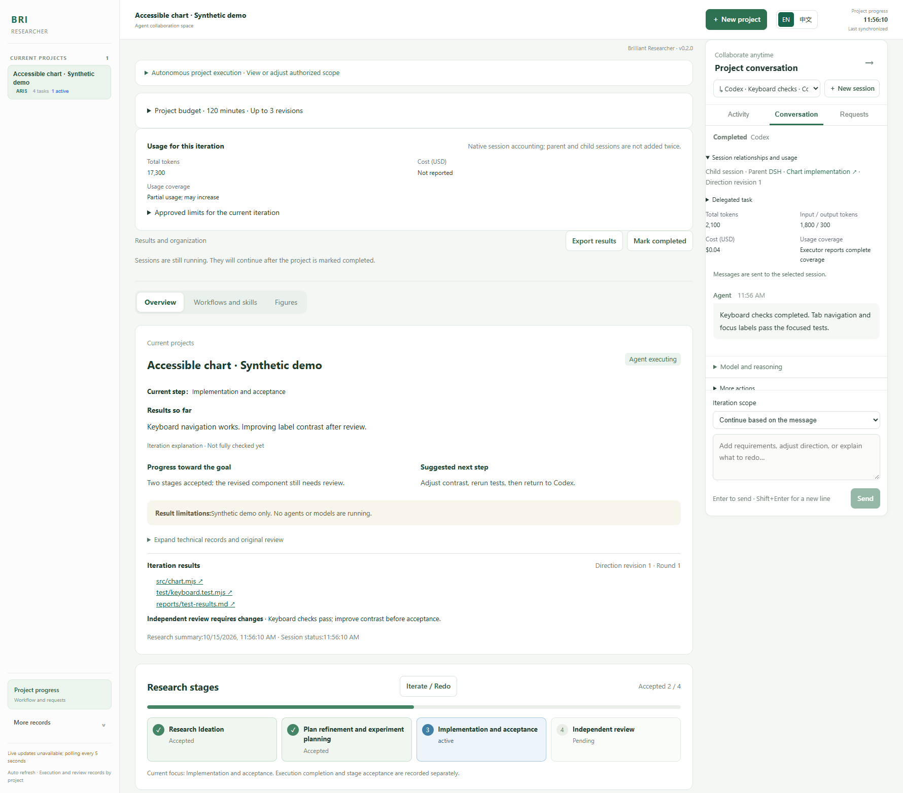
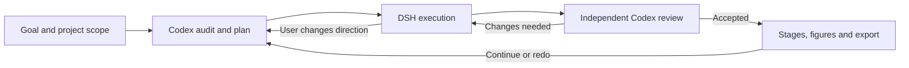

# Brilliant Researcher (BRI)

**An agent researcher built on ARIS, with a local workbench for execution, independent review, and continued iteration.**

[中文](README_CN.md) · [Workbench guide](docs/research-workbench.md) · [Architecture](docs/architecture.md)



*Interface preview with synthetic project, session, and progress data. No private research or real agent run is shown.*

Brilliant Researcher brings research goals, native coding agents, project conversations, research stages, and deliverables into one local dashboard. The default collaboration pairs **DSH as executor** with **Codex as independent reviewer**: execute a task, review its actual artifacts, repair the findings, and keep iterating. A new request can begin with a Codex audit of existing work and a concrete plan.

BRI builds on [ARIS — Auto-claude-code-research-in-sleep](https://github.com/wanshuiyin/Auto-claude-code-research-in-sleep). The included MIT-licensed files derive from [`2132036060e03e8d0df69a4b21e5971819c0c2d6`](https://github.com/wanshuiyin/Auto-claude-code-research-in-sleep/tree/2132036060e03e8d0df69a4b21e5971819c0c2d6) in [upstream/aris](upstream/aris). This release vendors selected public ARIS files with local integration adaptations, rather than a pristine complete upstream checkout. ARIS supplies the research skills and workflows; BRI adds the workbench and agent coordination around them. See [NOTICE](NOTICE) and the [upstream license](upstream/aris/LICENSE).

## What BRI adds

- A local project workbench: goals and scope, stage progress, native session activity, questions, and permissions.
- Persistent project conversations, backed by native DSH and Codex sessions; steer ongoing work from the same conversation.
- Independent artifact review and automatic repair within the authorized project scope.
- Native parent/child tasks with visible ownership, finite recovery, per-round budgets, and usage that preserves unknown values.
- Codex audit and planning before continued iteration or stage redo, with previous rounds retained.
- Figure discovery, stage association, deliverable ZIP export, and completed-project organization.



You can also start with a specific task instead of an audit. Free collaboration, an individual ARIS skill, and the full research workflow are distinct choices. Selecting a workflow or seeing a skill in the catalog does not mean it has run or passed review.

## Install and open the workbench

Requirements: **Node.js 24**, npm, and **Python 3** for ARIS helpers. The backend runs TypeScript directly and uses `node:sqlite`; an older Node installation is insufficient. Git is needed to clone the repository.

```sh
git clone https://github.com/ahian-lee/brilliant-researcher.git
cd brilliant-researcher
npm ci
npm run setup
npm run build
npm start
```

Open [http://127.0.0.1:8791](http://127.0.0.1:8791). Setup prepares local configuration; it does not install coding agents or provision model credentials. A running dashboard alone does not verify agent execution or scientific results. Use **EN / 中文** in the top bar for an English or Chinese interface; project content, agent output, and upstream skills retain their original language.

The workbench runs natively on Windows. Bash-based ARIS helpers currently run through WSL on Windows; install Python 3 and any dependencies needed by your selected skill there. Linux and macOS compatibility is intended, but complete platform workflows have not all been tested.

## Connect real coding agents

Install DSH and Codex separately and configure their model access. You need a working DSH profile with an available model and credentials, and an authenticated Codex installation. Model/API usage may incur provider charges; BRI does not supply API keys, subscription access, or free inference. Individual research skills may also require browser tools, LaTeX, scientific packages, datasets, or other services.

Use the interactive connection guide once for each agent you want to enable:

```sh
npm run connect
npm run doctor
npm start -- --with-runtime
```

`connect` lists local executable candidates and asks for the selected executable, existing home/profile and runtime port. It shows the proposed changes before saving and preserves unrelated settings and the project registry. It does not authenticate agents, read their credentials, or call models. `doctor` reports configuration, runtime health and provider discovery with `modelCalls: 0`; a successful listing does not prove authentication or inference. It is normal for runtime health to be unavailable before startup. Run it again in another terminal after startup to inspect the connection.

`--with-runtime` starts the configured native runtime when needed and the dashboard together. A runtime already serving that port is reused only when it identifies the same configuration; another configuration is left running and startup is refused. The launcher stops a runtime it owns when the dashboard exits. You can instead keep `npm run runtime` and `npm start` in separate terminals. Closing the browser does not stop the services; closing their launch terminal can. See [Architecture](docs/architecture.md#windows-background-hosting) for managed Windows hosting.

Advanced settings remain in `var/native-runtime.local.json` and `var/workbench.local.json`; see [examples](examples). Re-running setup creates missing files without replacing existing configuration.

The reviewer is selected from the available Codex model catalog. To choose a specific reviewer model and effort, set `reviewer.model` and `reviewer.thinkingOptionId` in `var/workbench.local.json`; an unavailable choice is rejected before creating sessions.

The implemented native drivers are DSH and Codex. Other agents can be added through the [NativeDriver interface](packages/adapters/src/native/types.ts); this is an extension point, not a claim that every agent is supported. Historical Pi/Direct integrations remain for compatibility and are not the default workbench path. Paseo is not required.

## Use and interpretation

Create a project with a clear goal, workspace, and constraints on cost, network use, and operations outside that workspace. All three task modes offer automatic execution and Codex review; disabling it starts direct execution without automatic independent acceptance. Optional budget fields use minutes, repair counts, tokens, USD, concurrent agents and total child sessions. Limits apply to each new collaboration round; unknown usage is not zero, and provider billing can arrive after a turn. See the guide for enforcement limits. Start a small task, inspect the artifacts and independent review, then expand the workflow. The [workbench guide](docs/research-workbench.md) describes questions, direction changes, iteration, export, and history.

`accepted` means that the corresponding artifacts passed the configured independent review. It is not a guarantee of scientific correctness. `done` or a completed agent turn only means execution ended. An audit returning `no_change` produces `audited` without new execution or new scientific acceptance.

The dashboard and runtime are designed for **localhost on a trusted machine**, without an internet-facing authentication boundary. Do not expose their ports to the internet. A full-access runtime option increases tool capability; it does not enlarge the user's authorized scope. See [SECURITY.md](SECURITY.md).

## Validation status

v0.2.0 passed a representative **Windows live-model acceptance run**: native DSH execution, two real child sessions (DSH and Codex), independent Codex rejection, automatic repair, and a direction change synchronized to both bound sessions. The final revised counter passed six tests and independent browser checks. A native question was answered in the workbench; real figure preview, result ZIP export and project completion were also checked. Token exhaustion stopped dispatch rather than granting acceptance, and restarting retained the original session identities.

Repository tests and CI do not establish that every bundled ARIS skill, every model, or a complete scientific research program has been validated. Private research data, credentials, and raw session records are excluded from this public source release.

## Upgrade from source

Use the source checkout you actually start as the canonical installation. Pause active work and stop only the services belonging to that installation; retain its `var/`, project workspaces, native agent homes and session records. Back up local state privately before an upgrade. Review local source changes, update that checkout with `git pull --ff-only`, then run `npm ci`, `npm run setup` and `npm start -- --with-runtime`. Normal startup rebuilds the dashboard from that source; `--no-build` is only for an already verified matching build. Do not overwrite local configuration with examples, copy another installation's `var/`, or update only `dist/`. An upgrade preserves records; it does not automatically resume interrupted work. See [Architecture](docs/architecture.md#source-and-deployment) for the deployment boundary.

## Develop and contribute

```sh
npm test
npm run test:workbench
npm run build
```

See [CONTRIBUTING.md](CONTRIBUTING.md), [Architecture](docs/architecture.md), and [CHANGELOG.md](CHANGELOG.md). BRI is released under [MIT](LICENSE); preserve upstream attribution and any additional notices included with third-party files.
