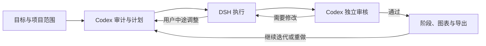

# Brilliant Researcher（BRI）

**基于 ARIS 的 agent researcher：用本地工作台连接执行、独立审核和持续迭代。**

[English](README.md) · [工作台使用说明](docs/research-workbench_CN.md) · [架构](docs/architecture_CN.md)

Brilliant Researcher 将研究目标、原生 coding agent、项目对话、研究阶段和成果放在同一个本地看板中。默认由 **DSH 执行、Codex 独立审核**：执行任务、检查实际成果、按审核意见返修，再继续推进。继续迭代或重做时，可以先让 Codex 审计现有成果并提出具体计划。

本项目基于 [ARIS — Auto-claude-code-research-in-sleep](https://github.com/wanshuiyin/Auto-claude-code-research-in-sleep)，在 [upstream/aris](upstream/aris) 包含来源于该版本的 MIT 许可文件 [`2132036060e03e8d0df69a4b21e5971819c0c2d6`](https://github.com/wanshuiyin/Auto-claude-code-research-in-sleep/tree/2132036060e03e8d0df69a4b21e5971819c0c2d6)。本次发布选取公开 ARIS 文件，并包含本地集成适配，不是完整未修改的上游 checkout。ARIS 提供研究技能和流程，BRI 增加本地工作台与 agent 协作能力。来源和许可见 [NOTICE](NOTICE) 与 [上游 LICENSE](upstream/aris/LICENSE)。

## BRI 增加了什么

- 本地项目看板：目标与范围、阶段进展、原生会话动态、待回答问题和权限请求。
- 持续项目对话：使用 DSH、Codex 原生会话，在同一入口发送任务和中途调整。
- 独立审核与自动返修：围绕实际成果，在已授权项目范围内推进。
- 继续迭代与阶段重做：Codex 先审计和规划，保留此前轮次、成果和验收记录。
- 图表发现与阶段关联、成果 ZIP 导出、已完成项目收纳。



任务明确时也可以直接执行。自由协作、单项 ARIS 技能与完整研究流程是不同入口；技能出现在目录中，或者流程被选中，都不代表已经执行或通过验收。

## 安装并打开工作台

需要 **Node.js 24**、npm，以及 ARIS 助手所需的 **Python 3**。后台直接执行 TypeScript 并使用 `node:sqlite`，旧版 Node 不满足要求。克隆仓库需要 Git。

```sh
git clone https://github.com/ahian-lee/brilliant-researcher.git
cd brilliant-researcher
npm ci
npm run setup
npm run build
npm start
```

打开 [http://127.0.0.1:8791](http://127.0.0.1:8791)。Setup 准备本地配置，不会安装 coding agent 或提供模型凭据。看板启动成功不能证明 agent 已能执行，也不能证明研究成果通过验收。顶部栏的 **EN / 中文** 按钮提供英文/中文界面切换；项目内容、agent 输出和上游技能原文按原语言保留。

工作台支持 Windows 原生运行；Windows 下基于 Bash 的 ARIS 助手目前通过 WSL 调用，需要在 WSL 中安装 Python 3 和所选技能的依赖。Linux、macOS 是兼容目标，尚不能声称各平台完整流程都已实测。

## 接入真实 coding agent

另行安装 DSH 与 Codex，并配置模型访问。DSH 需要可用 profile、模型和凭据，Codex 需要完成认证。模型调用可能产生提供方费用，BRI 不提供 API key、订阅权限或免费推理。具体技能还可能需要浏览器工具、LaTeX、科学计算依赖、数据集或其他服务。

参考 [examples/native-runtime.example.json](examples/native-runtime.example.json) 编辑 `var/native-runtime.local.json`；仅在本地文件不存在时复制示例。填写本机 agent 可执行文件、DSH 安装目录和 profile，并将已配置 agent 的 `enabled` 设为 `true`。在第二个终端启动原生后台：

```sh
npm run runtime
```

协作期间需同时保持看板与原生后台运行。关闭浏览器后后台仍可工作；关闭启动终端可能停止进程。Windows 后台托管说明见 [架构文档](docs/architecture_CN.md#windows-后台托管)。

当前实现的原生 driver 是 DSH 和 Codex。[NativeDriver 接口](packages/adapters/src/native/types.ts) 是其他 agent 的扩展点，不代表任意 agent 已经完成接入。历史 Pi/Direct 集成保留作兼容用途，不是默认路径。无需 Paseo。

## 使用与状态解释

新建项目时写清目标、工作目录，以及费用、联网和项目外操作的限制。建议先用小任务确认实际成果与独立审核，再扩展流程。[工作台使用说明](docs/research-workbench_CN.md) 包含问答、方向调整、继续迭代、导出和历史记录。

`accepted` 表示对应成果通过所配置的独立审核，不是科学正确性的保证。`done` 或会话结束只表示执行结束。审计返回 `no_change` 时，状态为 `audited`，没有新增执行，也没有产生新的科学验收。

工作台面向**可信机器上的 localhost**，没有面向互联网的身份认证边界，请勿将端口直接暴露到互联网。full-access 增加工具执行能力，不扩大用户授权范围。详见 [SECURITY.md](SECURITY.md)。

## 已验证范围

原生执行、独立审核、真实问答、自动返修和方向同步已在代表性组件上实跑。新审计计划 → 执行中调整方向 → 更新计划 → 执行 → 验收的迭代链也已由真实 agent 完成。部分 failure、unknown 和 `no_change` 分支使用隔离测试验证。

这些记录不代表所有 ARIS 技能、所有模型或完整科研任务均已通过验收。测试和 CI 验证软件行为；模型服务可用性与真实研究验收需要另行确认。公开源码不包含私人研究数据、凭据和原始会话记录。

## 开发与贡献

```sh
npm test
npm run test:workbench
npm run build
```

参见 [CONTRIBUTING.md](CONTRIBUTING.md)、[架构](docs/architecture_CN.md) 与 [CHANGELOG.md](CHANGELOG.md)。BRI 使用 [MIT 许可](LICENSE)，请保留上游归属和第三方文件附带的其他声明。

审核模型默认从 Codex 当前可用模型目录选择。需要指定时，在 `var/workbench.local.json` 设置 `reviewer.model` 与 `reviewer.thinkingOptionId`；不可用的配置会在创建会话前被拒绝。
