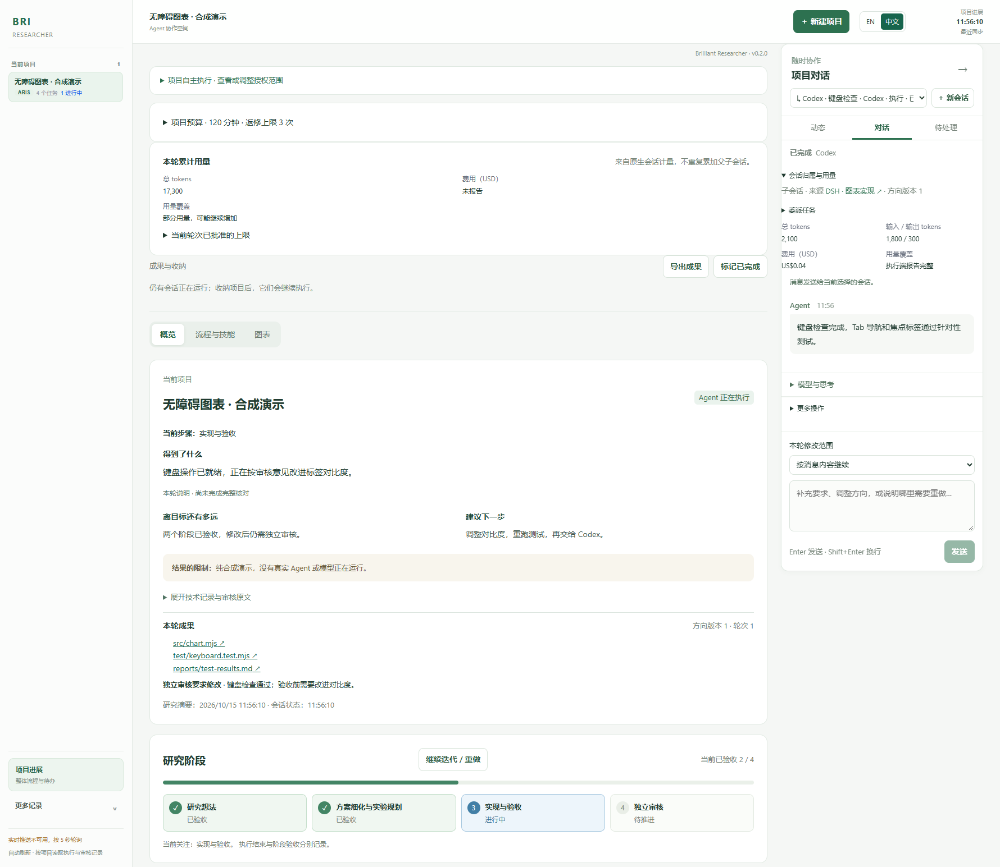
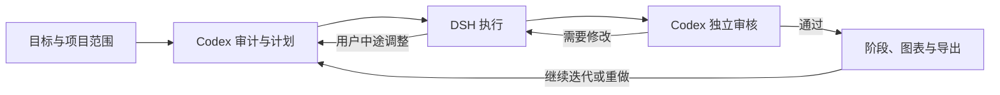

# Brilliant Researcher（BRI）

**基于 ARIS 的 agent researcher：用本地工作台连接执行、独立审核和持续迭代。**

[English](README.md) · [工作台使用说明](docs/research-workbench_CN.md) · [架构](docs/architecture_CN.md)



*界面演示：项目、会话和进度均为虚构数据，不包含私人研究内容，也不代表真实 Agent 运行。*

Brilliant Researcher 将研究目标、原生 coding agent、项目对话、研究阶段和成果放在同一个本地看板中。默认由 **DSH 执行、Codex 独立审核**：执行任务、检查实际成果、按审核意见返修，再继续推进。继续迭代或重做时，可以先让 Codex 审计现有成果并提出具体计划。

本项目基于 [ARIS — Auto-claude-code-research-in-sleep](https://github.com/wanshuiyin/Auto-claude-code-research-in-sleep)，在 [upstream/aris](upstream/aris) 包含来源于该版本的 MIT 许可文件 [`2132036060e03e8d0df69a4b21e5971819c0c2d6`](https://github.com/wanshuiyin/Auto-claude-code-research-in-sleep/tree/2132036060e03e8d0df69a4b21e5971819c0c2d6)。本次发布选取公开 ARIS 文件，并包含本地集成适配，不是完整未修改的上游 checkout。ARIS 提供研究技能和流程，BRI 增加本地工作台与 agent 协作能力。来源和许可见 [NOTICE](NOTICE) 与 [上游 LICENSE](upstream/aris/LICENSE)。

## BRI 增加了什么

- 本地项目看板：目标与范围、阶段进展、原生会话动态、待回答问题和权限请求。
- 持续项目对话：使用 DSH、Codex 原生会话，在同一入口发送任务和中途调整。
- 独立审核与自动返修：围绕实际成果，在已授权项目范围内推进。
- 原生父子任务：显示归属与状态，有限恢复，按轮次执行预算，保留未知用量。
- 继续迭代与阶段重做：Codex 先审计和规划，保留此前轮次、成果和验收记录。
- 图表发现与阶段关联、成果 ZIP 导出、已完成项目收纳。



任务明确时也可以直接执行。自由协作、单项 ARIS 技能与完整研究流程是不同入口；技能出现在目录中，或者流程被选中，都不代表已经执行或通过验收。

## 安装并打开工作台

需要 **Node.js 24**、npm，以及 ARIS 助手所需的 **Python 3**。后台直接执行 TypeScript 并使用 `node:sqlite`，旧版 Node 不满足要求。克隆仓库需要 Git。

```sh
git clone https://github.com/ahian-lee/brilliant-researcher.git
cd brilliant-researcher
npm ci
npm run setup
npm run build
npm start
```

打开 [http://127.0.0.1:8791](http://127.0.0.1:8791)。Setup 准备本地配置，不会安装 coding agent 或提供模型凭据。看板启动成功不能证明 agent 已能执行，也不能证明研究成果通过验收。顶部栏的 **EN / 中文** 按钮提供英文/中文界面切换；项目内容、agent 输出和上游技能原文按原语言保留。

工作台支持 Windows 原生运行；Windows 下基于 Bash 的 ARIS 助手目前通过 WSL 调用，需要在 WSL 中安装 Python 3 和所选技能的依赖。Linux、macOS 是兼容目标，尚不能声称各平台完整流程都已实测。

## 接入真实 coding agent

另行安装 DSH 与 Codex，并配置模型访问。DSH 需要可用 profile、模型和凭据，Codex 需要完成认证。模型调用可能产生提供方费用，BRI 不提供 API key、订阅权限或免费推理。具体技能还可能需要浏览器工具、LaTeX、科学计算依赖、数据集或其他服务。

对需要启用的 agent 分别运行交互式连接引导：

```sh
npm run connect
npm run doctor
npm start -- --with-runtime
```

`connect` 列出本机可执行文件候选路径，询问选定程序、现有 home/profile 和后台端口；保存前展示改动，保留其他设置和项目注册。它不完成 agent 认证、不读取凭据、不调用模型。`doctor` 检查配置、后台健康与提供方发现，并报告 `modelCalls: 0`；列出提供方不代表认证或推理成功。后台启动前显示尚未连接是正常情况；启动后可在另一终端再次检查。

`--with-runtime` 在需要时启动配置对应的原生后台，并启动看板。同端口已有后台仅在报告相同配置路径时复用；配置不同时拒绝启动，保留已有后台。看板退出时，启动器清理自己启动的原生后台。也可以在两个终端分别运行 `npm run runtime` 与 `npm start`。关闭浏览器不会停止服务，关闭启动终端可能停止进程。Windows 后台托管说明见 [架构文档](docs/architecture_CN.md#windows-后台托管)。

高级选项仍在 `var/native-runtime.local.json` 与 `var/workbench.local.json`，参考 [examples](examples)。重新运行 setup 只创建缺失文件，不替换已有配置。

审核模型默认从 Codex 当前可用模型目录选择。需要指定时，在 `var/workbench.local.json` 设置 `reviewer.model` 与 `reviewer.thinkingOptionId`；不可用的配置会在创建会话前被拒绝。

当前实现的原生 driver 是 DSH 和 Codex。[NativeDriver 接口](packages/adapters/src/native/types.ts) 是其他 agent 的扩展点，不代表任意 agent 已经完成接入。历史 Pi/Direct 集成保留作兼容用途，不是默认路径。无需 Paseo。

## 使用与状态解释

新建项目时写清目标、工作目录，以及费用、联网和项目外操作的限制。三种任务模式都可启用自动执行与 Codex 审核；关闭后直接执行，不会自动获得独立验收。可选预算使用分钟、返修次数、tokens、美元、同时运行 agent 数和累计子会话数。每个新协作轮次使用独立预算；未知用量不等于零，提供方计费可能在回合结束后才返回，执行限制见使用说明。建议先用小任务确认实际成果与独立审核，再扩展流程。[工作台使用说明](docs/research-workbench_CN.md) 包含问答、方向调整、继续迭代、导出和历史记录。

`accepted` 表示对应成果通过所配置的独立审核，不是科学正确性的保证。`done` 或会话结束只表示执行结束。审计返回 `no_change` 时，状态为 `audited`，没有新增执行，也没有产生新的科学验收。

工作台面向**可信机器上的 localhost**，没有面向互联网的身份认证边界，请勿将端口直接暴露到互联网。full-access 增加工具执行能力，不扩大用户授权范围。详见 [SECURITY.md](SECURITY.md)。

## 已验证范围

v0.2.1 修复复用 DSH 会话的预算计量，防止延迟的历史读取覆盖较新的控制器范围，并区分原生提交前的明确拒绝与提交后的未知结果。历史 tokens 缺失时，会话总用量仍为未知；仅在历史未计量事件身份集合不变、已报告累计值不倒退时，本轮 token 增量才可精确计算。新增缺项或倒退会在该轮 token 上限下阻断后续原生派发。这些框架修复不代表进行中的科研迭代已通过验收。

v0.2.0 已通过一次代表性的 **Windows 真实模型验收**：DSH 原生执行，实际启动 DSH、Codex 两个子会话，独立 Codex 拒绝故障交付后自动退回修复，中途新方向同步给双方。最终修改后的计数器通过 6 项测试和独立浏览器验证。原生问答已在看板答复，实际图表预览、ZIP 导出和项目收纳也已验证。触及 token 上限时后台停止派发，没有冒充验收通过；重启保留原会话身份。

测试与 CI 不代表全部 ARIS 技能、所有模型或完整科研任务已通过验收。公开源码不包含私人研究数据、凭据和原始会话记录。

## 从源码升级

以实际启动服务的源码 checkout 为唯一部署来源。先暂停活动任务，只停止属于该安装的服务；保留它的 `var/`、项目工作目录、原生 agent home 与会话记录，并在本机私下备份状态。检查本地源码改动后，用 `git pull --ff-only` 更新该 checkout，再运行 `npm ci`、`npm run setup`、`npm start -- --with-runtime`。普通启动会按当前源码重新构建界面；`--no-build` 只适用于已确认匹配的构建。不要用示例覆盖配置、复制另一安装的 `var/`，或只更新 `dist/`。升级保留记录，不代表自动恢复被打断任务。部署边界见 [架构](docs/architecture_CN.md#源码与部署)。

## 开发与贡献

```sh
npm test
npm run test:workbench
npm run build
```

参见 [CONTRIBUTING.md](CONTRIBUTING.md)、[架构](docs/architecture_CN.md) 与 [CHANGELOG.md](CHANGELOG.md)。BRI 使用 [MIT 许可](LICENSE)，请保留上游归属和第三方文件附带的其他声明。
