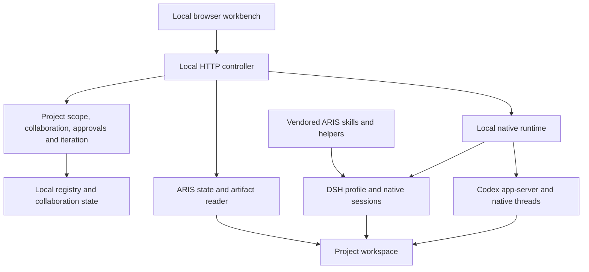

# Architecture

[中文](architecture_CN.md) · [Home](../README.md) · [Workbench guide](research-workbench.md)

Brilliant Researcher (BRI) uses ARIS research skills inside a local project workbench. The default agent path is native DSH execution with independent Codex review. Historical Direct/Pi paths remain for compatibility.

## Components

| Component | Source | Responsibility |
| --- | --- | --- |
| Browser | [apps/dashboard](../apps/dashboard) | Project overview, conversation, stages, questions, figures, export and history |
| Controller | [apps/controller](../apps/controller) | Local APIs, project coordination and serving the built dashboard |
| Core | [packages/core](../packages/core) | Project state, collaboration, iteration planning and scope decisions |
| Native runtime | [runner/native-runtime-host.ts](../runner/native-runtime-host.ts) | Native session operations behind a local HTTP interface |
| DSH driver | [dshDriver.ts](../packages/adapters/src/native/dshDriver.ts) | Native DSH events, prompts, resume, model selection and interactions |
| Codex driver | [codexDriver.ts](../packages/adapters/src/native/codexDriver.ts) | Codex app-server threads, turns, approvals and questions |
| ARIS reader | [arisReader.ts](../packages/adapters/src/arisReader.ts) | Read native run, review and trace information |
| Workspace reader | [arisWorkspace.ts](../packages/adapters/src/arisWorkspace.ts) | Discover skill definitions, stage artifacts and figures within a registered root |
| Export | [projectExport.ts](../packages/adapters/src/projectExport.ts) | Package supported project deliverables with explicit exclusions |
| Research foundation | [upstream/aris](../upstream/aris) | Vendored ARIS skills, workflow definitions and supporting tools |

The ARIS files derive from commit `2132036060e03e8d0df69a4b21e5971819c0c2d6`. This release vendors selected public files and includes local integration adaptations; it is not a pristine complete upstream checkout. See [NOTICE](../NOTICE) for attribution.

## Native sessions and collaboration

The runtime uses native DSH and Codex session identifiers and events. Each DSH session has its own process and native writer lease; Codex connects through its app-server protocol. BRI keeps local session metadata so it can reconnect or resume using those native records. Persistence does not imply that a stopped process continues running.

[NativeDriver](../packages/adapters/src/native/types.ts) defines model discovery, open/inspect/send, interruption, configuration, question/permission responses, and shutdown. DSH and Codex implement that interface. Supporting another coding agent requires an adapter and verification of those operations; selecting an arbitrary provider name does not implement them.

[workbenchCollaboration.ts](../apps/controller/src/workbenchCollaboration.ts) connects project collaboration to [collaborationLoop.ts](../packages/core/src/collaborationLoop.ts). The default cycle is DSH execution → independent Codex review → repair or acceptance. New iteration can start with a Codex audit and plan. Direction changes are synchronized to bound sessions and supersede the old round, so earlier results cannot count as acceptance of the changed request.

Ordinary work can proceed inside the declared project scope. Questions about scope, cost, resources or direction remain user decisions. Permission review and user questions use the existing project conversation. Broad runtime capability, including full access, does not grant additional user authorization.

### Parent and child lifecycle

The native collaboration bridge exposes `create_agent`, `get_agent`, `wait_agent` and `send_agent_prompt`. Registered children carry their parent session, collaboration, action, direction revision and task, and inherit the project working directory. Mutating collaboration calls identify their originating action and revision; expired work must not gain the authority of a later action. Child creation has a round-wide count limit and project concurrency limit. Parent completion is followed by child drainage before independent review. Pause and direction changes revoke old authority, request interruption and wait for observable quiescence; session records and artifacts remain available.

Recovery uses the original session and action, with separate finite allowances for continuation and format-only restatement. Uncertain sends are not replayed. Real blocked replies terminate with a reason; transport and inspection failures remain observable. The controller schedules project ticks independently with bounded concurrency and backoff, so one unavailable project need not stop all others.

### Budgets and metering

Project defaults are stored with workbench control; each new collaboration round copies its approved limits. Updating defaults does not silently enlarge an active round. Duration and repair defaults remain finite, with optional tokens, USD, concurrency and total-child limits. Runtime dispatch and core observation enforce the applicable scope for managed actions and registered children; direct workbench sends also receive a scope. These checks do not replace provider-side billing limits or cancel unreported consumption already in flight.

The backend's `native-session-delta` aggregate accounts for the current round across bound sessions and children. Missing tokens or cost remain unknown, and a configured limit that cannot be measured blocks further managed dispatch. UI session usage and run usage are distinct views, not totals to add together. Saving budget defaults does not resume an exhausted run.

## State and evidence

- Delivery acknowledgement confirms receipt of a request.
- A completed turn or `done` stage describes execution state.
- `accepted` records that the corresponding artifacts passed the configured independent reviewer.
- `audited` with a `no_change` plan records an audit without new execution or new scientific acceptance.
- Archiving a project organizes it in the completed list; it does not accept results or stop active sessions.

A workflow definition is a plan, not a result. The reader checks native artifacts and review information rather than treating every declared phase as completed. A model catalog is also distinct from the model recorded on a real turn. The UI presents configuration and runtime observations separately.

Prior rounds and their artifacts remain available. Stage progress is based on the applicable acceptance records, and stages affected by a redo are updated for the new round. Software acceptance does not substitute for domain assessment of a scientific claim.

## Local configuration and startup

`npm run setup` creates missing local files without overwriting existing configuration or project registration. `npm run connect` interactively selects executable paths, existing agent homes/profiles and a runtime port, preserves unrelated configuration and shows changes before writing. It installs no agents and reads no credentials. `npm run doctor` checks settings, health and provider discovery with no model calls; it does not verify authentication or inference.

`npm start` serves the workbench at port 8791, and `npm run dev` uses Vite. `npm start -- --with-runtime` can launch both services; it refuses to reuse a runtime reporting another configuration and leaves that runtime alone. The launcher cleans up a runtime it started, while an already running matching runtime remains independently owned. You may instead start `npm run runtime` separately; its default port is 8793. Advanced configuration is described by [examples](../examples).

Node.js 24 is required for direct TypeScript execution and `node:sqlite`. Python 3 is needed by ARIS helpers. On Windows the dashboard/controller and native runtime run directly, while Bash-based ARIS helpers use WSL. An individual skill may need additional packages, tools, credentials or datasets. An offline dashboard run exercises the web application, not a model call.

The top-bar **EN / 中文** selector, implemented in [i18n.tsx](../apps/dashboard/src/i18n.tsx), switches English and Chinese interface text. Project content, agent output, artifacts, and upstream skill text retain their original language. Core user documentation is available in both languages; MIT legal text and the complete upstream skill collection are not translated.

### Source and deployment

The source checkout used by the launcher is the canonical installation: startup rebuilds the UI from its current source unless `--no-build` was explicitly requested. Updating a separate checkout or copying a built UI does not update a running controller/runtime. Upgrade that installation as described in [README](../README.md#upgrade-from-source), restart its owned processes, and verify the served version and runtime connection. Keep local configuration, project roots and native session homes in place; do not publish them with source or replace them using another installation's state. No automatic updater or cross-installation state migration is provided.

### Windows background hosting

For Windows users who need background processes independent of their launch terminal, [DashboardWindowsHost.cs](../runner/DashboardWindowsHost.cs), [dashboard-readonly.ps1](../runner/dashboard-readonly.ps1) and [native-runtime-service.ps1](../runner/native-runtime-service.ps1) provide hosting components. Review their parameters and adapt them to your installation before use. They are an advanced deployment path, not required for the terminal-based quick start.

The dashboard host uses a detached child process and a Job Object to tie process cleanup to the owning host. The service scripts manage scheduled-task startup and recovery. Browser closure is separate from service shutdown; intentional shutdown must use the service's stop operation. Do not infer controller health from a surviving Vite development page.

Linux and macOS compatibility is intended, but complete service and real-agent flows have not all been exercised there. The current GitHub CI runs software checks on Ubuntu with Node 24; Windows service behavior and live provider access require local verification.

## Trust and data boundaries

The controller and native runtime are local tools for a trusted machine. The native runtime rejects browser-origin calls and requires its expected internal request header; that header is not an authentication secret. There is no internet-facing identity boundary. Keep the services bound to localhost.

Workspace readers constrain artifact access to registered project roots, including resolved symlink paths. Export excludes known credential, raw-session, dependency and cache paths and reports limits or failures. Review the ZIP before sharing: arbitrary research content can still contain sensitive text.

Local configuration, model credentials, research projects and native session records are not part of the public release. Native agents may send prompts and selected project content to their configured model providers; local hosting does not imply offline inference. See [SECURITY.md](../SECURITY.md).

## Verification boundaries

The [README](../README.md#validation-status) and [workbench guide](research-workbench.md#verification-boundaries) record the versions and scenarios exercised with real agents. [tests](../tests) contains runtime, collaboration, recovery, budget, scheduler, UI, workspace and export software checks. An isolated test, provider listing or build success does not prove live execution or scientific acceptance. Representative runs do not establish validation of every ARIS skill, model endpoint or operating system.
