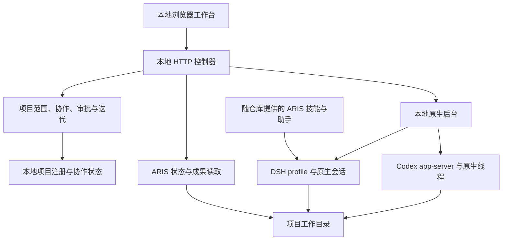

# 架构

[English](architecture.md) · [中文首页](../README_CN.md) · [工作台指南](research-workbench_CN.md)

Brilliant Researcher（BRI）在本地项目工作台中使用 ARIS 研究技能。默认路径由 DSH 原生会话执行，Codex 独立审核。历史 Direct/Pi 路径保留作兼容用途。

## 组件

| 组件 | 源码 | 职责 |
| --- | --- | --- |
| 浏览器 | [apps/dashboard](../apps/dashboard) | 项目概览、对话、阶段、问答、图表、导出与历史 |
| 控制器 | [apps/controller](../apps/controller) | 本地 API、项目协调与构建后界面服务 |
| 核心 | [packages/core](../packages/core) | 项目状态、协作、迭代规划与范围判断 |
| 原生后台 | [runner/native-runtime-host.ts](../runner/native-runtime-host.ts) | 通过本地 HTTP 接口提供原生会话操作 |
| DSH driver | [dshDriver.ts](../packages/adapters/src/native/dshDriver.ts) | DSH 原生事件、提示、恢复、模型选择与交互 |
| Codex driver | [codexDriver.ts](../packages/adapters/src/native/codexDriver.ts) | Codex app-server 线程、回合、审批与问题 |
| ARIS 读取器 | [arisReader.ts](../packages/adapters/src/arisReader.ts) | 读取原生运行、审核与 trace 信息 |
| 工作目录读取器 | [arisWorkspace.ts](../packages/adapters/src/arisWorkspace.ts) | 在已注册根目录中发现技能定义、阶段成果和图表 |
| 导出 | [projectExport.ts](../packages/adapters/src/projectExport.ts) | 按明确排除规则打包支持的项目成果 |
| 研究基础 | [upstream/aris](../upstream/aris) | 随仓库提供的 ARIS 技能、流程定义与辅助工具 |

ARIS 文件来源于 commit `2132036060e03e8d0df69a4b21e5971819c0c2d6`。本次发布选取公开文件，并包含本地集成适配，不是完整未修改的上游 checkout。归属说明见 [NOTICE](../NOTICE)。

## 原生会话与协作

后台使用 DSH、Codex 原生会话标识与事件。每个 DSH 会话拥有独立进程和原生写入租约；Codex 通过 app-server 协议连接。BRI 保留本地会话元数据，用于重新连接或恢复对应的原生记录。记录持久化不表示停止的进程还在运行。

[NativeDriver](../packages/adapters/src/native/types.ts) 定义模型发现、打开/读取/发送、打断、配置、问题和权限答复，以及关闭操作。DSH 与 Codex 已实现该接口。接入其他 coding agent 需要编写 adapter 并验证这些操作；填写一个 provider 名称不会自动完成接入。

[workbenchCollaboration.ts](../apps/controller/src/workbenchCollaboration.ts) 将项目协作连接到 [collaborationLoop.ts](../packages/core/src/collaborationLoop.ts)。默认循环为 DSH 执行 → Codex 独立审核 → 返修或验收。新迭代可以从 Codex 审计与计划开始。方向调整会同步到已绑定会话并替代旧轮次，之前的结果不能作为调整后任务的验收。

普通工作可在已声明的项目范围内推进。范围、费用、资源和方向问题仍由用户决定。权限复核与问题使用现有项目对话。包括 full access 在内的宽泛执行能力不增加用户授权。

## 状态与证据

- 送达确认表示收到请求。
- 完成的回合或 `done` 阶段描述执行状态。
- `accepted` 表示对应成果通过所配置的独立审核。
- `audited` 配合 `no_change` 计划表示只完成审计，没有新增执行或新的科学验收。
- 收纳项目只是把项目放入已完成列表，不会验收成果或停止活动会话。

流程定义是计划，不是结果。读取器检查原生成果和审核记录，不会把所有声明的阶段自动视为完成。模型目录也不同于真实回合记录的实际模型，界面分别展示配置和运行观测。

之前的轮次与成果保持可查。阶段进展依据适用的验收记录，重做影响的阶段会在新轮次中更新。软件验收不代替领域专家对科学主张的判断。

## 本地配置与启动

`npm run setup` 准备本地配置，不覆盖已有文件。`npm start` 在 8791 端口提供工作台服务；`npm run dev` 使用 Vite 开发服务器。原生 agent 后台是独立进程，配置 `var/native-runtime.local.json` 后用 `npm run runtime` 启动，默认端口为 8793。从 [配置示例](../examples) 开始，只显式启用已安装并认证的 agent。

直接执行 TypeScript 与使用 `node:sqlite` 需要 Node.js 24。ARIS 助手需要 Python 3。Windows 下看板/控制器和原生后台直接运行，基于 Bash 的 ARIS 助手通过 WSL 调用。具体技能可能需要额外的软件包、工具、凭据和数据集。离线看板运行验证网页应用，不会验证模型调用。

界面通过顶部栏的 **EN / 中文** 按钮切换英文和中文，具体实现在 [i18n.tsx](../apps/dashboard/src/i18n.tsx)。语言切换只影响界面文案，保留项目内容、agent 输出、成果和上游技能的原语言。核心使用文档提供两种语言版本；MIT 法律文本和上游技能不做全量翻译。

### Windows 后台托管

需要进程脱离启动终端的 Windows 用户，可使用 [DashboardWindowsHost.cs](../runner/DashboardWindowsHost.cs)、[dashboard-readonly.ps1](../runner/dashboard-readonly.ps1) 与 [native-runtime-service.ps1](../runner/native-runtime-service.ps1) 提供的托管组件。使用前查看参数并适配本机安装。这是高级部署方式，终端快速启动不需要它。

看板宿主使用 detached 子进程和 Job Object，把清理行为绑定到拥有进程的宿主。服务脚本管理计划任务启动和恢复。关闭浏览器不同于停止服务；主动停止时应使用服务的 stop 操作。Vite 开发页面仍能访问不能证明控制器正常。

Linux、macOS 是兼容目标，但完整服务和真实 agent 流程尚未全部实测。Windows 原生 CI 检查软件行为；真实提供方访问仍需本机运行验证。

## 信任与数据边界

控制器与原生后台面向可信机器上的本地使用。原生后台拒绝来自浏览器 Origin 的调用，并要求内部请求头；该请求头不是身份认证密钥。服务没有面向互联网的身份边界，请保持绑定 localhost。

工作目录读取器把成果访问限制在已注册项目根目录内，包括符号链接解析后的路径。导出排除已知凭据、原始会话、依赖和缓存路径，并明确报告限制或错误。分享前检查 ZIP：研究文档和数据自身仍可能包含敏感内容。

本地配置、模型凭据、研究项目和原生会话记录不进入公开发布。原生 agent 可能把提示与选定项目内容发送给配置的模型提供方；本地托管不意味着离线推理。详见 [SECURITY.md](../SECURITY.md)。

## 验证边界

代表性真实 agent 运行已验证执行、审核、问答、返修、方向同步及迭代至验收。部分异常分支使用隔离测试。[tests](../tests) 包含原生后台、协作、规划、工作目录与导出检查。这些检查不代表所有 ARIS 技能、模型服务、科学主张或操作系统都已验证。
